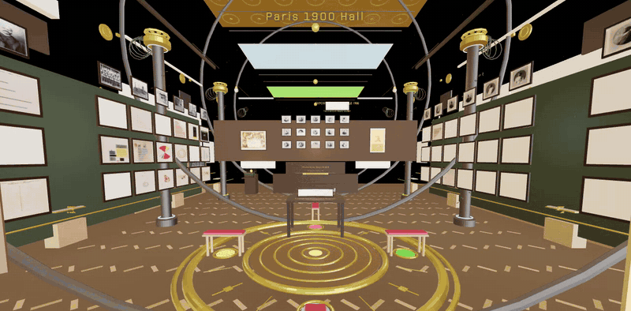

# Du Bois Does Data: the Paris 1900 Hall

Walk into the hall where W.E.B. Du Bois and his Atlanta University students showed their hand-drawn data portraits of Black life in America, at the 1900 Paris Exposition.

**Try it:** [vr-cave-gallery.vercel.app/#hall](https://vr-cave-gallery.vercel.app/#hall) (desktop, phone, or a Meta Quest headset)

## What it does

- **A room you can stand in.** The hall is built in WebXR, so it runs in a browser and in a headset. Look around, walk the aisles, step up to a chart.
- **Every chart is the real one.** 69 of the exhibit's charts hang in the hall, each titled and linked to its Library of Congress record (LOT 11931), read off the item itself.
- **Credit where it's due.** Each chart names its series: the Georgia series by Du Bois, the national series by his Atlanta University students. The title panel credits Du Bois, his students, Thomas J. Calloway and Daniel Murray, and names the colonial displays that shared the fair.
- **The sound of the year.** Period records play in the hall: the Dinwiddie Colored Quartet, Victor, 1902 (public domain, Library of Congress National Jukebox).

## How it's built

React Three Fiber and WebXR on Vite, deployed on Vercel. Plate metadata is generated from the Library of Congress catalog, not typed by hand. A cultural review checks every caption against its source before release.

## Demo, in captions

**▶ [Watch the demo](https://radicalimagination.xyz/demos/paris-hall.mp4)** (silent, captioned, under 30 seconds)

A 30 to 40 second screen recording. No voiceover; these are the on-screen captions.

1. "Paris, 1900. The American Negro Exhibit."
2. "Charts drawn by hand by W.E.B. Du Bois and his Atlanta University students."
3. "69 of them, hung where you can walk up to them."
4. "Each one linked to its Library of Congress record."
5. "The music is from 1902: the Dinwiddie Colored Quartet."
6. "Du Bois Does Data. Radical Imagination."

## Related

- [dubois-does-data-notebooks](https://github.com/ShdwSpde/dubois-does-data-notebooks): open, Colab-ready notebooks that rebuild the charts with today's data.
- [dubois-does-data-lessons](https://github.com/ShdwSpde/dubois-does-data-lessons): the classroom lessons.
- Shown with CUNY's Public Interest Technology Lab at the Juneteenth exhibition at the Oculus, June 2026.

The application code lives in a private repository. This page is the public showcase.

**Radical Imagination**, a cultural technology studio in Queens. [radicalimagination.xyz](https://radicalimagination.xyz)
